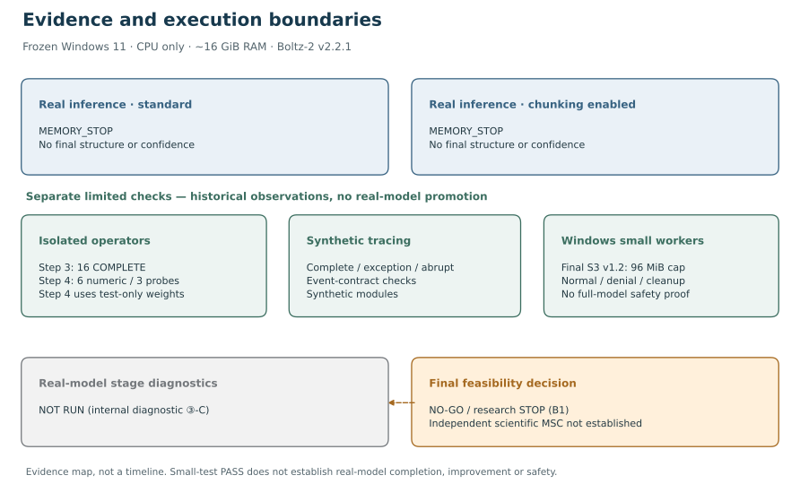
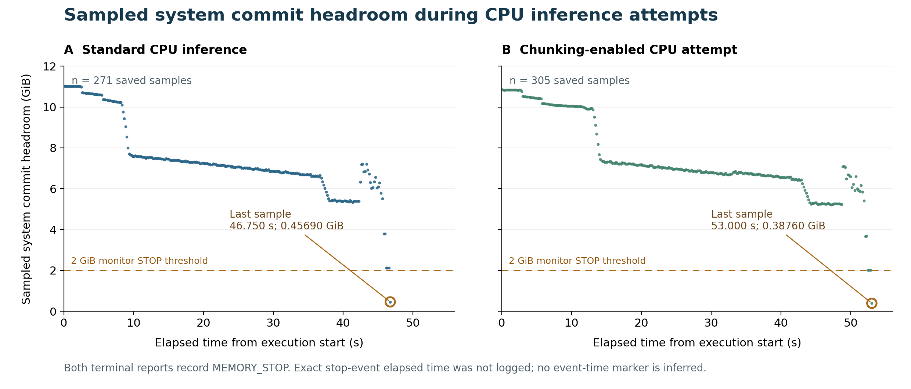

# Boltz-2 CPU Execution and Diagnostic Boundaries: A Windows 11 Technical Record

**Technical Record · v1.0.0 candidate · unpublished**  
**Sho Miyazaki · Independent researcher, Tokyo, Japan**  
Prepared 4 November 2026 (JST). **GitHub repository (private pre-release):** [https://github.com/shomiyazaki-ai/boltz2-cpu-execution-diagnostic-boundaries](https://github.com/shomiyazaki-ai/boltz2-cpu-execution-diagnostic-boundaries). **Initial staging commit:** `16cd45cffe05e8a7c2b6dd16ac4211db31cd7035` (historical reference, not the final release commit). **Zenodo version DOI reserved in an unpublished draft:** `10.5281/zenodo.23934898` (not yet a published DOI record). GitHub `v1.0.0` tag, final release commit and Zenodo publication: **PENDING**.

## 1. At a Glance

Two fixed Boltz-2 v2.2.1 inference attempts on a personal Windows 11 CPU-only PC with approximately 16 GiB RAM ended **MEMORY_STOP**. One used the standard configuration; the other recorded application of a local adapter intended to select existing official chunking branches. Actual entry into the patched MSA-module boundary during real inference was not traced. **Neither produced a successful prediction return, final structure or final confidence result.** The memory-limiting operation was not identified.

Separate isolated-operator, synthetic-trace and small Windows-worker checks provide limited implementation evidence. They do not establish successful or safer full-model inference. Real-model stage diagnostics were **NOT RUN**. The final feasibility review was **NO-GO / research STOP**. Independent scientific minimum contribution (MSC) has **not been established** for C, D or C+D; this is a bounded technical record.

| Reader goal | Start here |
| --- | --- |
| What was learned | [Principal findings](#3-principal-findings) and [verification boundaries](data/table2_verification_levels.csv) |
| Where the evidence is | [Claim crosswalk](data/table3_claim_evidence_crosswalk.csv) and [source-to-public manifest](docs/EVIDENCE_MANIFEST.csv) |
| What can be verified | [Read-only verification](verification/REPRODUCIBILITY.md) |
| What was not demonstrated | [Limitations and STOP](#10-limitations-no-go-and-stop) |

## 2. Research Scope and Technical Questions

This record asks whether the fixed CPU inference completed with the standard path or with existing official chunking enabled, what the isolated checks support, and whether synthetic and small-worker checks justified proceeding to real-model diagnostics. The targets were MPC2 (O95563, chain A) and MPC1L (P0DKB6, chain B), with 263 combined residue tokens.

The CPU execution record (internal unit **C**) and instrumentation/safety record (**D**) form one technical resource. The separate [C01 A+B structural-comparison work](https://doi.org/10.5281/zenodo.23910491) uses a fixed Atlas Boltz-2 **v2.1.1** structure and an exploratory fixed AlphaFold structure. Its outputs, structural results and MSC assessment are not results of the **v2.2.1** attempts documented here. No new seed cohort was completed.

## 3. Principal Findings

**Table 1 — Recorded CPU inference outcomes.** [Machine-readable table](data/execution_summary.csv). Gate B is the post-load approval gate; its row contains the separate snapshot saved in each run report. All terminal rows are the last saved monitoring sample, **not peaks**.

| Metric | Standard | Chunking-enabled configuration |
| --- | ---: | ---: |
| Monitor samples | 271 | 305 |
| Gate B report snapshot, commit headroom (GiB) | 5.39557 | 5.25733 |
| Terminal sampled commit headroom (GiB) | 0.45690 | 0.38760 |
| Terminal sampled available physical RAM (GiB) | 2.22477 | 1.87646 |
| Terminal sampled process-tree RSS (MiB) | 8515.270 | 8678.559 |
| Terminal sampled process-tree Private Bytes (MiB) | 10881.168 | 10875.980 |
| Last sample elapsed time (s) | 46.750 | 53.000 |
| Outcome | MEMORY_STOP | MEMORY_STOP |
| Final structure / confidence | Not produced | Not produced |

“Not produced” is the saved-record assessment: `prediction_success=false`, no `TRAINER_PREDICT_RETURNED`, and output QC `NOT_RUN`. The standard output-QC record also states `NO_SUCCESSFUL_PREDICT_RETURN`. It is not a fresh file-system census of the original PC or an independently completed output-quality assessment.



**Figure 1 — Evidence and execution boundaries.** This is an evidence map, **not a strict chronology**. The real attempts and three families of limited checks are distinct evidence levels. Small-test PASS records do not promote the real-model result to PASS. The final feasibility decision preserves the unperformed real-model stage diagnostics and research STOP. [State source](figures/figure1_states.json).

## 4. Frozen Environment and Inputs

| Setting | Frozen value / evidence |
| --- | --- |
| Platform | Personal Windows 11 PC; CPU-only; approximately 16 GiB RAM (author-confirmed); OS build and CPU model not recorded here |
| Model | Boltz-2 v2.2.1; confidence checkpoint identity in [checkpoint metadata](evidence/cpu_run_records/checkpoint_metadata.json) |
| Precision / seed / threads | FP32 (`32-true`) / 101 / 4 |
| Recycling / sampling / samples / step scale | 3 / 200 / 1 / 1.5 |
| Original chain-A / chain-B MSA | 8116 / 7149 rows before parsing and deduplication |
| Per-chain preprocessing cap | 4096; this is not the combined feature-row count |
| Combined `PredictionDataset` MSA | 6634 × 263; fully paired rows 2539 |
| Historical runtime observation | Python 3.10.11 and PyTorch 2.14.1+cpu in the Step 4 report; not an installation recommendation |

The [two configs](evidence/cpu_run_records/standard_config.json), [MSA rescue report](evidence/cpu_run_records/msa_rescue_qc.json), [real-dataset inspection](evidence/cpu_run_records/msa_dataset_qc.json), and [environment summary](data/frozen_environment.json) preserve the distinctions. The MSA report's synthetic cap scan is **not** the real `PredictionDataset` observation. These denominators must not be exchanged.

Checkpoint SHA256: `090e82ac8c92f5e943fa1b39e7410a44027bea7243c0bbb3caa67a77fc1428e1`. This identifies a historical load-only report; the checkpoint is not supplied or rehashed here. Original MSA sequences, A3M, NPZ, pickle, molecular caches and checkpoint bytes are excluded. Their absence prevents rebuilding the historical inputs through V1. No OS build, CPU model or unrecorded dependency version has been inferred.

## 5. CPU Execution and Memory Observations

The supervisor sampled global available physical RAM and **system commit headroom**, together with process-tree RSS and Private Bytes. Its monitor STOP rule was available RAM **<2 GiB or commit headroom <2 GiB**; this was a polling rule, not an OS memory cap. The run reports explicitly state `memory_guard_os_hard_limit=false`. Kill-on-close support does not itself impose a memory limit. [Inert source excerpt](evidence/isolated_operator_tests/memory_stop_rule_excerpt.json).



**Figure 2 — Sampled system commit headroom during CPU inference attempts.** Panel A: standard (271 samples); Panel B: chunking-enabled configuration (305 samples). Both include loading and prediction phases. Each point is one saved sample; there is **no interpolation, smoothing or extrapolation**. Axes share the same scales. The dashed 2 GiB line is the commit component of the polling STOP rule. Open endpoint markers show the last samples at 46.750 s / 0.45690 GiB and 53.000 s / 0.38760 GiB. The terminal reports record MEMORY_STOP, but no separate stop-event elapsed timestamp is saved, so **no event-time tick is invented**. System headroom is not per-process or Job commit; it does not identify a tensor, allocation peak, exact continuous crossing time, or hard containment. [All 576 samples](data/memory_samples_curated.csv) · [generation source](figures/make_figures.py).

Every earlier saved commit sample was at or above 2 GiB. The immediately preceding samples were 46.562 s / 2.12656 GiB and 52.813 s / 2.01932 GiB. Thus the terminal samples are the first observed commit-threshold breaches. This does not measure what happened between samples. The standard terminal physical-RAM value remained above 2 GiB; the chunking attempt's was below it. Neither result is a confirmed allocator OOM exception.

The first `GATE_B_PASS` monitoring samples are **5.39563 / 5.25620 GiB**, not the report's **5.39557 / 5.25733 GiB**. The supervisor takes a separate `snapshot()` for gate approval and labels subsequent monitor iterations with the stage. Table 1 preserves the report values and does not pretend to reconstruct them from a different sample. The terminal-report UTC fields are **2026-11-01T10:16:48.511436+00:00** and **2026-11-02T01:15:38.708419+00:00**; they are report timestamps, not synchronized inference-start or stop-event times.

RSS counts resident pages; process-tree Private Bytes is a separate process accounting measure. Neither is identical to Job-wide committed memory. System commit headroom also includes activity outside the monitored process tree. These fixed, unreplicated observations do not establish chunking superiority, a general minimum RAM requirement, or a whole-model memory reduction.

## 6. Official Chunking and Isolated Tests

Official Boltz-2 already implements chunked Transition and OuterProductMean operations and size-dependent MSA-module branch selection. The local adapter selected existing arguments for the 263-token case: Transition hidden chunk **32**, OuterProductMean projected chunk **4**. It is not a new algorithm. The chunking-enabled run records adapter application before checkpoint load; actual entry into the patched MSA-module boundary during that real attempt was not traced. Consequently, MEMORY_STOP must not be represented as a verified execution of the chunked operator itself. [Official sources and fingerprints](docs/SOURCE_PROVENANCE.md).

The isolated-operator memory checks (**Step 3**) produced **16 COMPLETE** child records. The largest standard controls had 1536 × 263 input dimensions; 3072 × 263 and 6634 × 263 were chunking-only cases. Child `rss_end_mib` values can be inspected in the [saved results and summary](data/isolated_test_summary.csv). Aggregate `peak_sampled_rss_mib` came from the **launcher PID**, so it is not an operator peak and is not used here. End RSS also depends on allocator retention and is not a peak.

Step 3 zero outputs reflect the official final-projection initialization; they are not a nontrivial numerical-parity demonstration. The separate numerical checks (**Step 4**) used deterministic **nonzero test-only final weights**, with no checkpoint loaded. Six small standard/chunked comparisons recorded equal shape, finite values, unchanged RNG states and `torch.allclose(atol=1e-5, rtol=1e-5)`. Three branch probes recorded intended arguments at token counts 64, 263 and 385. [Result](evidence/isolated_operator_tests/step4_results.json) · [inert method excerpt](evidence/isolated_operator_tests/step4_test_weights_excerpt.json). Saved summary flags can be inspected; tensors are not supplied, so V1 does not recompute allclose or RNG equality.

**Table 2 — Verification levels and boundaries.** [Complete machine-readable table](data/table2_verification_levels.csv).

| Evidence level | Saved result | Boundary |
| --- | --- | --- |
| Real standard / chunking-enabled attempts | MEMORY_STOP / MEMORY_STOP | No final prediction; no model-memory improvement established |
| Isolated operators, Step 3 | 16 COMPLETE | End RSS only; zero outputs; no operator peak |
| Test-only numerics, Step 4 | Six numeric and three probe PASS records | No checkpoint-weight or whole-model equivalence |
| Synthetic diagnostics | Complete, exception and abrupt examples | Synthetic modules; no real-model allocator localization |
| Final small-worker regression, S3 v1.2 | Five case PASS flags | 96 MiB examples; no multi-GiB model safety proof |
| Real-model stage diagnostics, internal ③-C | NOT RUN | No real-model stage observation |
| Final feasibility review, B1 | NO-GO / STOP | No evidence-qualified operating window; no universal impossibility proof |

## 7. Diagnostic Instrumentation and Windows Job Tests

Synthetic diagnostic instrumentation recorded a **26-event** completed trace with balanced entries/exits, four MSA-module and four Pairformer-module entries, and `TRACE_COMPLETE`. The exception example ends `TRACE_INCOMPLETE`; an abrupt example contains a single unmatched entry and no success marker. Event names resembling real Boltz modules describe the synthetic harness in these logs. [Traces](evidence/diagnostic_tests) support event-contract inspection, not real-model measurements.

Windows Job Objects, Job-wide committed-memory limits and kill-on-close are existing Microsoft facilities. The final small-worker dynamic regression (**S3 v1.2**, source package label; result-directory identity `C01_S3_Result_003`) recorded membership confirmation before resuming the worker and readback of a **100663296-byte (96 MiB)** Job limit. This result identity matters because both old and final summary JSON files retain the same generic `C01_S3_DYNAMIC_V1` schema version.

| Final case | Terminal observation | Worker exit |
| --- | --- | ---: |
| Normal | NORMAL_COMPLETE | 0 |
| Over limit | MEMORY_ERROR_OBSERVED | 42 |
| Deliberate exception | WORKER_EXCEPTION | 1 |
| No cap control | NORMAL_COMPLETE; limit disabled | 0 |
| Parent termination | Saved `child_gone_after_parent_kill=true`; controller exit 1 | Not recorded as a normal worker exit |

[Final summary](evidence/diagnostic_tests/s3_final_summary.json) · [case events/readbacks](evidence/diagnostic_tests/s3_final) · [derived table](data/diagnostic_test_summary.csv).

The over-limit `PeakJobMemoryUsed` readback was **101978112 bytes**, numerically above the configured 100663296-byte limit. This record does not resolve that accounting detail and does not establish a strict observed-counter bound. A Job commit counter is not physical RAM, process-tree Private Bytes or system commit headroom. Small-worker cleanup/denial observations cannot establish safe production inference. Real-model stage instrumentation (**internal diagnostic ③-C**) remained **NOT RUN**; no multi-GiB Windows test was added.

## 8. Evidence, Provenance, and Verification

**Table 3 — Claim-to-evidence crosswalk.** The [full CSV](data/table3_claim_evidence_crosswalk.csv) contains each claim, source PACK, source-internal path, original SHA256, public path, verification operation, scope and limitation. The [manifest](docs/EVIDENCE_MANIFEST.csv) additionally resolves source-archive identity, canonical PACK path, public-file SHA256 and transformation for every selected file. The compact reading map is:

| Claim | Claim family | Public evidence / limitation |
| --- | --- | --- |
| CD01 | Two failed real attempts; no final output | [Run records](evidence/cpu_run_records); historical output assessment |
| CD02 | Sampled memory and STOP boundary | [Curated samples](data/memory_samples_curated.csv); separate gate snapshots |
| CD03 | Frozen settings and MSA denominators | [Environment](data/frozen_environment.json); no MSA/checkpoint redistribution |
| CD04 | Existing official chunking and local adapter | [Chunking report](evidence/cpu_run_records/chunking_report.json); no real module-entry trace |
| CD05 | Sixteen isolated-operator checks | [Child results](evidence/isolated_operator_tests/step3); no operator peak |
| CD06 | Six test-weight checks and three probes | [Step 4](evidence/isolated_operator_tests/step4_results.json); saved flags, no tensors |
| CD07 | Synthetic event contract | [Completed trace](evidence/diagnostic_tests/synthetic_events.jsonl); synthetic scope |
| CD08 | Final small-worker regression | [Final S3](evidence/diagnostic_tests/s3_final_summary.json); historical Windows logs |
| CD09 | Superseded PASS inconsistencies | [Correction history](docs/SUPERSEDED_CHECKS.md); original labels retained |
| CD10 | Diagnostics not run; NO-GO / STOP | [B1 decision](evidence/stop_decisions/b1_decision.json); decision provenance |

Published files are **curated copies or numbered excerpts**. PID, thread identifiers, process creation data, command-line tails and local absolute paths are removed. Numeric samples, statuses and relevant event ordering are preserved. The original PACKs remain unchanged and are not included. A source SHA256 identifies private evidence but does not make it publicly available or independently recomputable. Public hashes authenticate the distributed copies relative to this candidate, not the truth of a historical execution.

The attached Evidence Index has 650 rows / 490 distinct content hashes across all C01; C+D contributes 306 provenance rows / 205 within-PACK unique items. The Source Register has **72 entries: 67 ZIP, one Markdown, two JSON and two TXT**. “70 ZIP + two TXT” in the request is corrected from the actual register. These are inventory counts, not independent validation or scientific-result counts. Only the provided PACK 04/05 ZIPs and assessment archive were freshly CRC-checked; underlying source ZIPs and PACK 01–03 were not supplied for fresh CRC testing. [Source details](docs/SOURCE_PROVENANCE.md).

## 9. Failed and Superseded Checks

Earlier Job cleanup tests (**Step 6**) labelled the normal case PASS while the saved `parent_done.json` reports **child_exitcode=1**. The superseded small-worker run (`C01_S3_Result_002`) marked normal and unlimited cases PASS with worker exit 0 despite terminal **WORKER_EXCEPTION**. Neither is evidence of normal-path success.

The final S3 v1.2 result (`C01_S3_Result_003`) instead records **NORMAL_COMPLETE / 0** for normal and unlimited cases, **MEMORY_ERROR_OBSERVED / 42** for overlimit, and **WORKER_EXCEPTION / 1** for the injected exception. Use that bounded record for the normal-path claim. The old labels remain visible in curated evidence, with [explicit correction history](docs/SUPERSEDED_CHECKS.md); they are not silently converted into failures or erased. The final regression does not retrospectively validate the old runs.

## 10. Limitations, NO-GO, and STOP

This record does **not establish** successful full-model inference, end-to-end memory reduction, full-model numerical equivalence, the memory-limiting operation, safe real-model execution under a validated cap, a universal minimum RAM requirement, general chunking superiority or independent scientific MSC.

The safety-gate stage (**S4** in the historical workflow) is not a new dynamic test. No standalone S4 decision file was identified in the supplied PACK 04/05 inventory; this record relies on the published bounded gate excerpt and the later final feasibility review (**B1**) for the documented decision. B1 states that no evidence-qualified cap had been shown both to protect system margins and to reach an informative diagnostic phase. Its decision was **NO_GO_TO_B2_UNDER_FIXED_STOP_RULE**. This is an evidence-limited decision for the then-current machine and inputs, not proof that all 16 GiB PCs must fail or that no theoretical safe cap exists.

**Research STOP** remains in force. Publication QC is a separate check of the correctness and completeness of this resource; a publication-QC PASS cannot authorize research resumption, confer novelty, or validate production safety.

## 11. Repository Contents and Reproducibility

| Route | What the reader does | Scope |
| --- | --- | --- |
| V0 — Inspect | Read this README, figures, tables, manifest and curated evidence | Understand observations and boundaries |
| V1 — Verify | Run the standard-library verifier below on a clean extracted candidate | Check hashes, sample arithmetic, saved states, event contract and links |
| V2 — Historical inspection | Examine fixed settings, source identities, saved Windows test records and corrections | Inspect history; no successful real-model reproduction is supplied |

```bash
python verification/verify_record.py
```

On Windows, `py -3 verification/verify_record.py` is equivalent. Python 3.10+ is sufficient; no pip install, network, checkpoint, model, GPU, large tensor or Windows Job test is needed. The verifier prints JSON to stdout, exits nonzero on failure, and does not write files. Run it before modifying the extracted tree. `.git/` and Python cache files are ignored; other unexpected files are reported. Keep environments outside the candidate tree. [Exact procedure and limits](verification/REPRODUCIBILITY.md).

`data/` contains the three main tables, sample projection and environment summary; `evidence/` contains the curated records; `docs/` contains provenance, selection, attribution and corrections; `figures/` contains exactly two figures plus their data and generation source. Optional figure rebuilding writes only into an explicitly supplied output directory and needs matplotlib; it does not rerun the study.

## 12. Rights, AI Disclosure, and Citation

**Author:** Sho Miyazaki. **Affiliation:** Independent researcher, Tokyo, Japan. **Funding:** “No specific funding was received for this independent study.” **Competing interests:** “The author declares no competing interests.” The study used a personal Windows PC; no institutional computing resources or research funds were used, and it was not an institutional research project or official institutional output. No specific acknowledgments are required.

Original prose, figures, tables and author-origin factual-record curation are **CC BY 4.0**. The CFF `license` field is intentionally omitted: a CFF license array denotes alternatives (OR), not the file-specific CC BY / MIT split. Newly authored verification and figure-generation code is **MIT**. External sources retain their rights; no Boltz implementation, local chunking adapter, executable historical launcher, MSA sequences or checkpoint is distributed. [License scope](LICENSE_SCOPE.md) · [rights and attribution](docs/RIGHTS_AND_ATTRIBUTION.md) · [MIT](LICENSE).

AI assisted the historical workflow and the current organization, English drafting, figure/code production and QC. Historical Windows execution evidence is inherited from the author's runs; it was not dynamically rerun here. This work's later QC used a separate comparison path in the **same Work**, not external independent peer review. The author remains responsible for interpretation, rights, publication scope and final approval. [Full disclosure](docs/AI_DISCLOSURE.md).

Provisional unpublished citation: Miyazaki, S. *Boltz-2 CPU Execution and Diagnostic Boundaries: A Windows 11 Technical Record*. Version 1.0.0, unpublished release candidate. **Reserved Zenodo version DOI:** `10.5281/zenodo.23934898` (confirmed in the author-provided Zenodo draft preview; not published). Cite the DOI as a published record **only after** Zenodo Publish and public resolution have been confirmed. GitHub repository: [https://github.com/shomiyazaki-ai/boltz2-cpu-execution-diagnostic-boundaries](https://github.com/shomiyazaki-ai/boltz2-cpu-execution-diagnostic-boundaries) (private as verified at the initial staging commit `16cd45cffe05e8a7c2b6dd16ac4211db31cd7035`); final release tag/commit and actual publication date remain pending. [CITATION.cff](CITATION.cff) supports GitHub citation display. Zenodo gives `.zenodo.json` precedence over CFF during linked release archiving. Direct Zenodo deposit, with both file-scoped licenses explicitly selected, is the recommended route for this mixed-license **Other / Technical Record** resource; “Technical Record” is a descriptive label, not an asserted special Zenodo subtype. [Publication metadata and checklist](docs/RELEASE_METADATA_AND_CHECKLIST.md).
